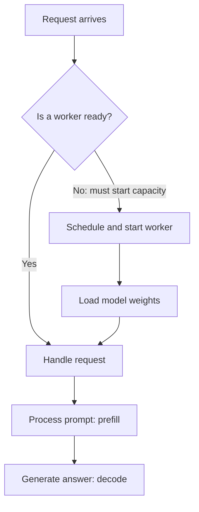
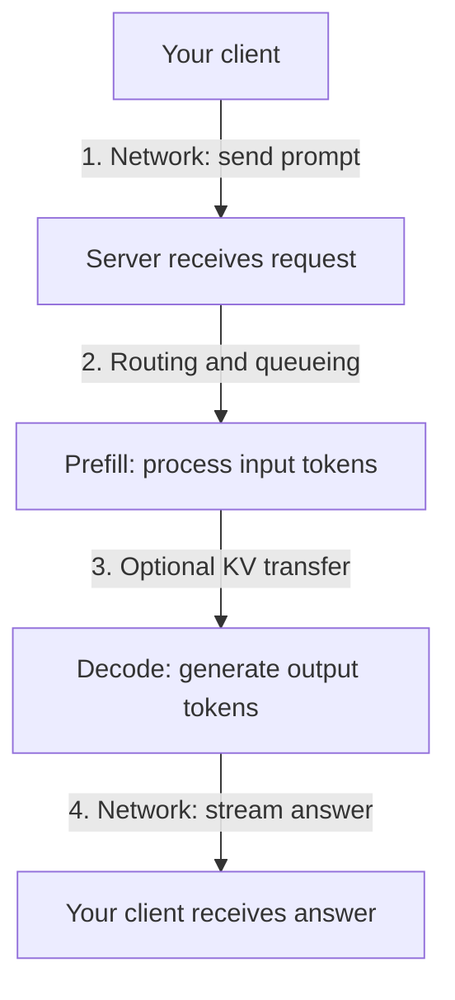
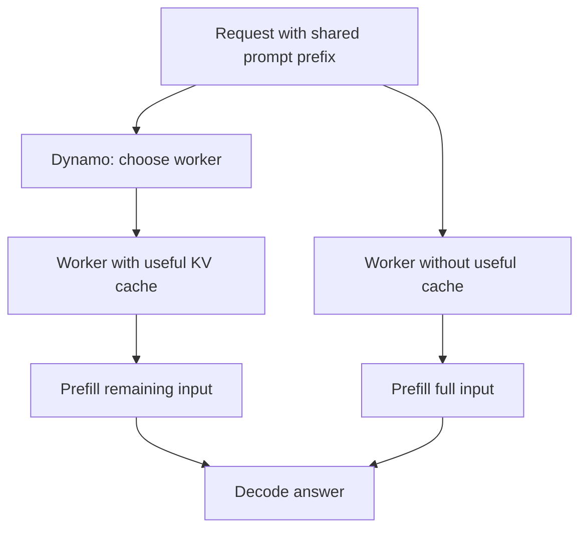
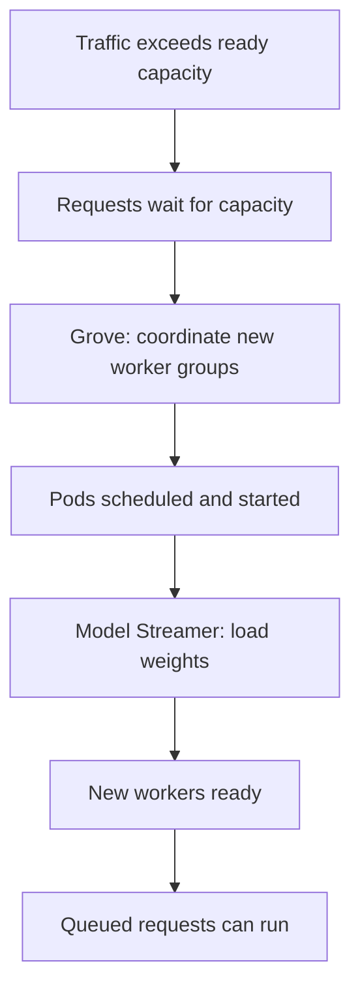

# Where inference latency comes from
Dynamo, Grove, and Model Streamer are software tools, not AI models. Each addresses a different part of an inference system.

## Startup versus serving
Separate a worker becoming ready from a ready worker answering a request. Stages may overlap; this is a simplified view.

Grove manages starting and scaling coordinated worker groups. Model Streamer targets weight loading. Dynamo coordinates the serving path.

## Where time goes for a ready worker

- **Time to first token (TTFT):** time until the answer begins. Includes network, routing, queueing, prefill, any required handoff, and first-token generation/delivery.
- **Inter-token latency:** how smoothly the answer continues. Decode computation, scheduling, and response delivery affect it.
- **End-to-end latency:** time until the full response has arrived.

A long prompt can make prefill slow. A long answer requires many decode steps. A busy server can make queueing dominate even when model computation is fast. These are conceptual components, not an exact additive formula: streaming, scheduling, and transfers can overlap.

## Which tool targets which delay?

| Source of delay | Example | Most relevant tool | Contribution |
|---|---|---|---|
| Client/server network | User is far from data center | None directly | Region, network path, connection reuse |
| Routing and imbalance | Some workers are overloaded | Dynamo | Coordinate requests across workers |
| Repeated prompt computation | Requests share a long system prompt | Dynamo + engine caching | Route toward reusable KV cache |
| Prefill/decode interference | Long prompts compete with generation | Dynamo + engine | Support separate prefill/decode workers |
| GPU computation | Attention or matrix operations are slow | Inference engine | Kernels, batching, execution optimizations |
| New capacity becoming available | Replica needs coordinated pods | Grove | Workload lifecycle, dependencies, scaling |
| Loading model weights | New worker waits for weight files | Model Streamer | Concurrent reads and pipelined GPU transfers |

The underlying engine, such as vLLM, SGLang, or TensorRT-LLM, executes the model. None of these tools guarantees lower latency without measurement.

## Dynamo: reduce waiting and unnecessary computation

These branches illustrate alternative execution paths, not duplicate execution of one request. Cache-aware routing can reduce prompt computation and TTFT. It does not shorten the user's internet round trip. Reuse depends on the engine, configuration, cache availability, and matching prefix.

Dynamo can coordinate prefill on one worker and decode on another. Separation may reduce contention but introduces KV-cache transfer across the data-center network. Measure computation saved, queueing, and transfer cost together.

## Grove and Model Streamer: new capacity readiness

This is an illustrative capacity expansion path, not a claim that Grove itself detects traffic or that every queued request starts a worker.

**Grove** expresses roles, dependencies, startup order, and scaling rules. It manages coordinated Kubernetes workloads, including groups of pods that must operate together. Readiness still depends on GPU availability, the scheduler, image pulling, and initialization. It can integrate with Dynamo or be used independently.

**Model Streamer**, when integrated with the engine, accelerates reading weights and transferring them to GPU memory. Its primary benefit is reducing model-loading time during cold starts. Once the model is loaded, it generally does not speed up each subsequent token.

## Three different network paths

| Network path | What moves | Relevant connection |
|---|---|---|
| User/service | Prompts and generated answers | Deployment location and network infrastructure |
| Worker/worker | KV state in disaggregated serving | Dynamo architecture and transfer layer |
| Storage/worker | Model weights during startup | Model Streamer loading pipeline |

Network bandwidth and network latency are distinct. Large weight or KV transfers can be bandwidth-bound; small request round trips can be latency-sensitive.

## Apply this to the lab

1. Establish a ready-worker baseline: measure end-to-end latency and throughput with the existing client.
2. Add streaming measurements for TTFT and token delivery intervals. Stream chunks are not necessarily individual tokens.
3. Separate queueing, prefill, decode, and transfer time using backend metrics or traces where supported.
4. For capacity expansion, measure scheduling, container startup, model loading, and full readiness separately.
5. Compare configurations with identical models, hardware, workloads, and cache conditions.

The current benchmark is non-streaming. It measures end-to-end request latency; it does not isolate these components or implement Dynamo, Grove, or Model Streamer.

## References
- [Dynamo overview](https://docs.nvidia.com/dynamo/)
- [Grove overview](https://developer.nvidia.com/grove)
- [Model Streamer loading explanation](https://developer.nvidia.com/blog/reducing-cold-start-latency-for-llm-inference-with-nvidia-runai-model-streamer/)
- [Model Streamer repository](https://github.com/dsx-ai-factory/model-streamer)
